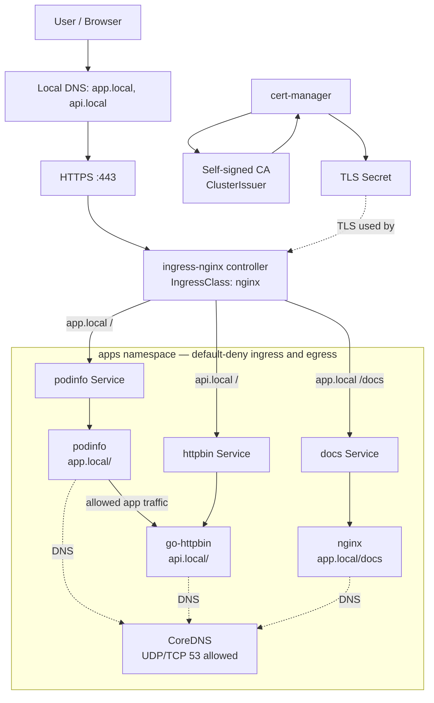

# Project 2: Secure Web Apps with Ingress, TLS, and NetworkPolicies

This project replaces several high-port NodePort services and unrestricted
pod-to-pod traffic with a single Ingress entry point, friendly hostnames,
automatically issued HTTPS certificates, and default-deny network policies.

The examples below build the lab on Minikube. The current `deployment.yaml` and
`service.yaml` files are empty placeholders; the manifests in this guide are
the working reference configuration.

## Architecture



Only the Ingress controller may initiate connections to application pods.
Podinfo may also call go-httpbin. All application pods may query CoreDNS;
other traffic is denied by default.

## Components and routes

| Component | Route or purpose |
| --- | --- |
| podinfo | `https://app.local/` |
| nginx | `https://app.local/docs` |
| go-httpbin | `https://api.local/` |
| ingress-nginx | The cluster's HTTP/HTTPS entry point |
| cert-manager | Issues and renews the Ingress TLS certificate |
| Self-signed CA ClusterIssuer | Signs the local lab certificate |
| `httpbin-alias` ExternalName Service | DNS alias for `httpbin.apps.svc.cluster.local` |
| Calico | CNI that enforces the NetworkPolicies |

## Prerequisites

- `kubectl`, Minikube, and Helm installed
- A host that can run Minikube with at least 2 CPUs and 4 GiB of memory
- Permission to add local host entries (or use `minikube tunnel`)

## 1. Start Minikube

Use Calico because the CNI, rather than Kubernetes itself, enforces
NetworkPolicies.

```bash
minikube start --cni=calico --cpus=2 --memory=4096
minikube addons enable ingress
```

Check that the controller is ready:

```bash
kubectl get pods -n ingress-nginx
kubectl get ingressclass
```

The Ingress examples use `ingressClassName: nginx`.

## 2. Install cert-manager

```bash
helm repo add jetstack https://charts.jetstack.io
helm repo update
helm upgrade --install cert-manager jetstack/cert-manager \
  --namespace cert-manager --create-namespace \
  --set crds.enabled=true
kubectl rollout status deployment/cert-manager -n cert-manager
kubectl rollout status deployment/cert-manager-webhook -n cert-manager
```

Create a self-signed bootstrap issuer and use it to create the CA key pair:

```yaml
apiVersion: cert-manager.io/v1
kind: ClusterIssuer
metadata:
  name: selfsigned-bootstrap
spec:
  selfSigned: {}
---
apiVersion: cert-manager.io/v1
kind: Certificate
metadata:
  name: local-root-ca
  namespace: cert-manager
spec:
  isCA: true
  commonName: local Kubernetes lab CA
  secretName: local-root-ca
  privateKey:
    algorithm: ECDSA
    size: 256
  issuerRef:
    name: selfsigned-bootstrap
    kind: ClusterIssuer
    group: cert-manager.io
```

Save that YAML as `ca-bootstrap.yaml`, then apply and wait for the CA:

```bash
kubectl apply -f ca-bootstrap.yaml
kubectl wait --for=condition=Ready certificate/local-root-ca \
  -n cert-manager --timeout=120s
```

Create the ClusterIssuer that signs the app certificate:

```yaml
apiVersion: cert-manager.io/v1
kind: ClusterIssuer
metadata:
  name: local-ca
spec:
  ca:
    secretName: local-root-ca
```

Save this as `ca-issuer.yaml` and apply it:

```bash
kubectl apply -f ca-issuer.yaml
kubectl get clusterissuer
```

## 3. Deploy the applications and Services

Save the following as `apps.yaml` and apply it. The ExternalName Service is a
DNS alias only; it does not create a proxy or bypass NetworkPolicy enforcement.

```yaml
apiVersion: v1
kind: Namespace
metadata:
  name: apps
---
apiVersion: apps/v1
kind: Deployment
metadata:
  name: podinfo
  namespace: apps
spec:
  replicas: 1
  selector:
    matchLabels:
      app: podinfo
  template:
    metadata:
      labels:
        app: podinfo
    spec:
      containers:
        - name: podinfo
          image: ghcr.io/stefanprodan/podinfo:6.7.1
          ports:
            - name: http
              containerPort: 9898
---
apiVersion: v1
kind: Service
metadata:
  name: podinfo
  namespace: apps
spec:
  selector:
    app: podinfo
  ports:
    - name: http
      port: 80
      targetPort: http
---
apiVersion: apps/v1
kind: Deployment
metadata:
  name: httpbin
  namespace: apps
spec:
  replicas: 1
  selector:
    matchLabels:
      app: httpbin
  template:
    metadata:
      labels:
        app: httpbin
    spec:
      containers:
        - name: httpbin
          image: mccutchen/go-httpbin:v2.14.0
          ports:
            - name: http
              containerPort: 8080
---
apiVersion: v1
kind: Service
metadata:
  name: httpbin
  namespace: apps
spec:
  selector:
    app: httpbin
  ports:
    - name: http
      port: 80
      targetPort: http
---
apiVersion: v1
kind: Service
metadata:
  name: httpbin-alias
  namespace: apps
spec:
  type: ExternalName
  externalName: httpbin.apps.svc.cluster.local
---
apiVersion: apps/v1
kind: Deployment
metadata:
  name: docs
  namespace: apps
spec:
  replicas: 1
  selector:
    matchLabels:
      app: docs
  template:
    metadata:
      labels:
        app: docs
    spec:
      containers:
        - name: nginx
          image: nginx:1.27-alpine
          ports:
            - name: http
              containerPort: 80
---
apiVersion: v1
kind: Service
metadata:
  name: docs
  namespace: apps
spec:
  selector:
    app: docs
  ports:
    - name: http
      port: 80
      targetPort: http
```

```bash
kubectl apply -f apps.yaml
kubectl rollout status deployment/podinfo -n apps
kubectl rollout status deployment/httpbin -n apps
kubectl rollout status deployment/docs -n apps
```

## 4. Configure Ingress and TLS

Save as `ingress.yaml`. The separate `/docs` Ingress rewrites the matched path
to `/`, so the stock nginx image displays its welcome page.

```yaml
apiVersion: networking.k8s.io/v1
kind: Ingress
metadata:
  name: web-tools
  namespace: apps
  annotations:
    cert-manager.io/cluster-issuer: local-ca
spec:
  ingressClassName: nginx
  tls:
    - hosts:
        - app.local
        - api.local
      secretName: web-tools-tls
  rules:
    - host: app.local
      http:
        paths:
          - path: /
            pathType: Prefix
            backend:
              service:
                name: podinfo
                port:
                  number: 80
    - host: api.local
      http:
        paths:
          - path: /
            pathType: Prefix
            backend:
              service:
                name: httpbin
                port:
                  number: 80
---
apiVersion: networking.k8s.io/v1
kind: Ingress
metadata:
  name: docs
  namespace: apps
  annotations:
    nginx.ingress.kubernetes.io/rewrite-target: /
spec:
  ingressClassName: nginx
  rules:
    - host: app.local
      http:
        paths:
          - path: /docs
            pathType: Prefix
            backend:
              service:
                name: docs
                port:
                  number: 80
```

```bash
kubectl apply -f ingress.yaml
kubectl get ingress -n apps
kubectl wait --for=condition=Ready certificate/web-tools-tls \
  -n apps --timeout=180s
kubectl get certificate,certificaterequest -n apps
```

Cert-manager's Ingress shim creates the `Certificate` from the annotated
Ingress. The `local-ca` ClusterIssuer signs it and stores the result in
`web-tools-tls`. The ingress-nginx controller redirects HTTP to HTTPS when TLS
is configured for the host.

## 5. Apply default-deny NetworkPolicies

Save as `network-policies.yaml` and apply only after the pods and Services are
created. Policies are additive: the two allow policies open only the required
flows over the default-deny baseline.

```yaml
apiVersion: networking.k8s.io/v1
kind: NetworkPolicy
metadata:
  name: default-deny
  namespace: apps
spec:
  podSelector: {}
  policyTypes:
    - Ingress
    - Egress
---
apiVersion: networking.k8s.io/v1
kind: NetworkPolicy
metadata:
  name: allow-ingress-controller
  namespace: apps
spec:
  podSelector: {}
  policyTypes:
    - Ingress
  ingress:
    - from:
        - namespaceSelector:
            matchLabels:
              kubernetes.io/metadata.name: ingress-nginx
          podSelector:
            matchLabels:
              app.kubernetes.io/name: ingress-nginx
              app.kubernetes.io/component: controller
---
apiVersion: networking.k8s.io/v1
kind: NetworkPolicy
metadata:
  name: allow-podinfo-to-httpbin
  namespace: apps
spec:
  podSelector:
    matchLabels:
      app: httpbin
  policyTypes:
    - Ingress
  ingress:
    - from:
        - podSelector:
            matchLabels:
              app: podinfo
      ports:
        - protocol: TCP
          port: 8080
---
apiVersion: networking.k8s.io/v1
kind: NetworkPolicy
metadata:
  name: allow-podinfo-egress-to-httpbin
  namespace: apps
spec:
  podSelector:
    matchLabels:
      app: podinfo
  policyTypes:
    - Egress
  egress:
    - to:
        - podSelector:
            matchLabels:
              app: httpbin
      ports:
        - protocol: TCP
          port: 8080
---
apiVersion: networking.k8s.io/v1
kind: NetworkPolicy
metadata:
  name: allow-dns-egress
  namespace: apps
spec:
  podSelector: {}
  policyTypes:
    - Egress
  egress:
    - to:
        - namespaceSelector:
            matchLabels:
              kubernetes.io/metadata.name: kube-system
          podSelector:
            matchLabels:
              k8s-app: kube-dns
      ports:
        - protocol: UDP
          port: 53
        - protocol: TCP
          port: 53
```

```bash
kubectl apply -f network-policies.yaml
kubectl get networkpolicy -n apps
```

> **CNI note:** NetworkPolicy resources are only effective when the CNI enforces
> them. If a policy unexpectedly has no effect, confirm Minikube started with
> Calico and inspect Calico and pod events before continuing.

## 6. Map local hostnames and verify HTTPS

Choose either local host entries or a Minikube tunnel.

### Option A: Add host entries

```bash
MINIKUBE_IP="$(minikube ip)"
echo "$MINIKUBE_IP app.local api.local" | sudo tee -a /etc/hosts
```

If the Ingress controller is not reachable at the Minikube IP on ports 80 and
443 for your driver, use Option B or the driver's port-forwarding setup.

### Option B: Use a Minikube tunnel

In a separate terminal, keep this running:

```bash
minikube tunnel
```

Use the Ingress address shown by `kubectl get ingress -n apps` for local host
entries if it differs from `minikube ip`.

Export the CA certificate and add it to your operating system's trusted
certificate store if you want browsers and curl to trust the lab certificate:

```bash
kubectl get secret local-root-ca -n cert-manager \
  -o jsonpath='{.data.tls\.crt}' | base64 -d > local-root-ca.crt
```

Keep the CA private key in the cluster; do not export or distribute it. To test
before trusting the CA, use `curl -k`:

```bash
curl -kI https://app.local/
curl -k https://app.local/docs
curl -k https://api.local/get
curl -I http://app.local/
```

The HTTP request should redirect to HTTPS. The routes should return podinfo,
the nginx welcome page, and a go-httpbin response, respectively.

## 7. Prove allowed and blocked connectivity

Run a temporary diagnostic pod in the `default` namespace. It is intentionally
outside the restricted `apps` namespace: it can reach the Ingress controller,
but direct connections from it to application pods are not allowed by the
`apps` ingress policies.

```bash
kubectl run netshoot --image=nicolaka/netshoot --restart=Never \
  --command -- sleep 3600
kubectl wait --for=condition=Ready pod/netshoot --timeout=120s
```

DNS lookups should work, including the ExternalName CNAME:

```bash
kubectl exec netshoot -- nslookup httpbin.apps.svc.cluster.local
kubectl exec netshoot -- nslookup httpbin-alias.apps.svc.cluster.local
```

To verify DNS egress while the `apps` policies are active, create a second
netshoot pod in that namespace:

```bash
kubectl run netshoot-app -n apps --image=nicolaka/netshoot \
  --restart=Never --command -- sleep 3600
kubectl wait --for=condition=Ready pod/netshoot-app -n apps --timeout=120s
kubectl exec -n apps netshoot-app -- \
  nslookup httpbin.apps.svc.cluster.local
kubectl exec -n apps netshoot-app -- \
  nslookup httpbin-alias.apps.svc.cluster.local
```

Direct access to the internal API from netshoot should time out or fail:

```bash
kubectl exec netshoot -- \
  curl --connect-timeout 3 http://httpbin.apps.svc.cluster.local/
```

Access through the Ingress controller should succeed. This is an allowed flow
because the controller, not netshoot, connects to the application backend:

```bash
kubectl exec netshoot -- \
  curl -k --connect-to \
  app.local:443:ingress-nginx-controller.ingress-nginx.svc.cluster.local:443 \
  https://app.local/
```

Clean up the diagnostic pod:

```bash
kubectl delete pod netshoot -n default --ignore-not-found
kubectl delete pod netshoot-app -n apps --ignore-not-found
```

## 8. Trace a request to its Pod

Trace `https://api.local/` through DNS, Ingress, Service, EndpointSlice, and the
selected pod:

```bash
# Host resolution (from your workstation)
getent hosts api.local

# Ingress host/path rule
kubectl describe ingress web-tools -n apps

# Service selector and port mapping
kubectl describe service httpbin -n apps

# Endpoints resolved by Kubernetes for the Service
kubectl get endpointslice -n apps \
  -l kubernetes.io/service-name=httpbin -o wide

# Pod IP and labels; compare the IP with the EndpointSlice above
kubectl get pods -n apps -l app=httpbin -o wide --show-labels
```

The Service selector matches the pod labels; the EndpointSlice contains the
ready pod IP and target port. kube-proxy programs the node's data plane rules
(iptables or the mode used by the cluster) to forward Service traffic to those
endpoints. Ingress-nginx uses the Service/endpoints to proxy the request to the
backend.

## Troubleshooting drills

- **DNS fails from `apps`:** Check that `allow-dns-egress` selects the app pods,
  CoreDNS has the `k8s-app=kube-dns` label, and both UDP and TCP port 53 are
  allowed. As a drill, remove the DNS policy and observe lookups fail; reapply
  it afterward.
- **Ingress returns the default-backend 404:** Check `ingressClassName`, host
  header, Ingress events, and controller logs:
  `kubectl logs -n ingress-nginx deploy/ingress-nginx-controller`.
- **Certificate is not Ready:** Inspect
  `kubectl describe certificate web-tools-tls -n apps`, then the related
  CertificateRequest and ClusterIssuer. Ensure the CA Secret exists in the
  `cert-manager` namespace and the issuer is Ready.
- **NetworkPolicy has no effect:** Confirm Calico is running. Check policy
  selectors and labels, then verify the source pod's namespace and labels.
- **`/docs` returns 404:** Check the docs Ingress rewrite annotation, its
  backend Service, and the docs EndpointSlice.

## Cleanup

Remove the lab resources and cert-manager after the exercise:

```bash
kubectl delete namespace apps
kubectl delete clusterissuer local-ca selfsigned-bootstrap
kubectl delete certificate local-root-ca -n cert-manager
helm uninstall cert-manager -n cert-manager
kubectl delete namespace cert-manager
minikube addons disable ingress
minikube stop
```

Remove the `app.local` and `api.local` entries from `/etc/hosts` if you added
them. Keep the root CA trusted only while needed; remove it from your trust
store afterward.

## Learning outcomes

- How Services, kube-proxy, iptables, and EndpointSlices work together
- How IngressClass, host/path rules, and controller annotations route traffic
- How cert-manager Issuers, ClusterIssuers, Certificates, and TLS Secrets fit
  together
- How CoreDNS search paths and ExternalName Services resolve
- How NetworkPolicy selectors and CNI enforcement restrict pod communication